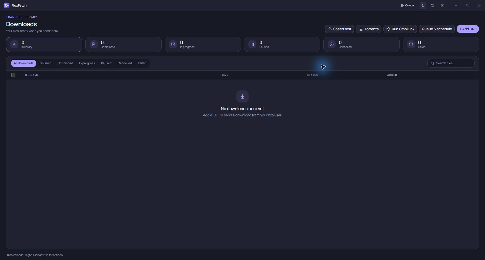
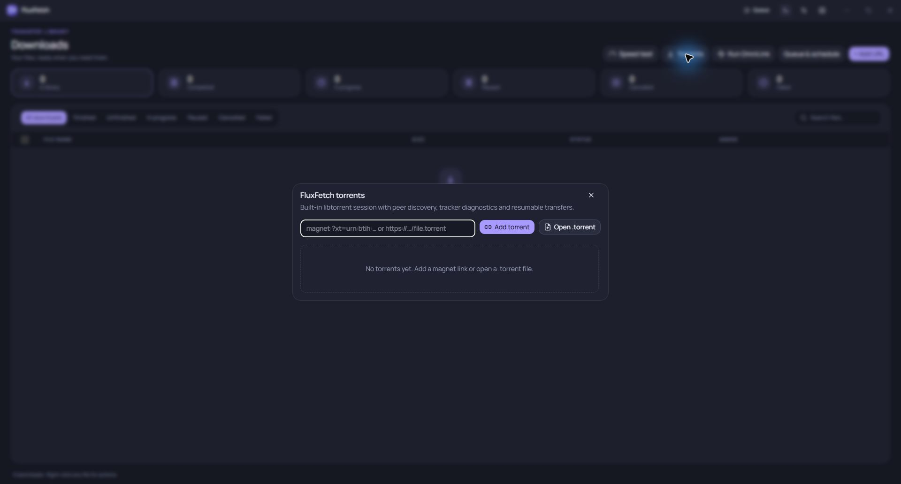
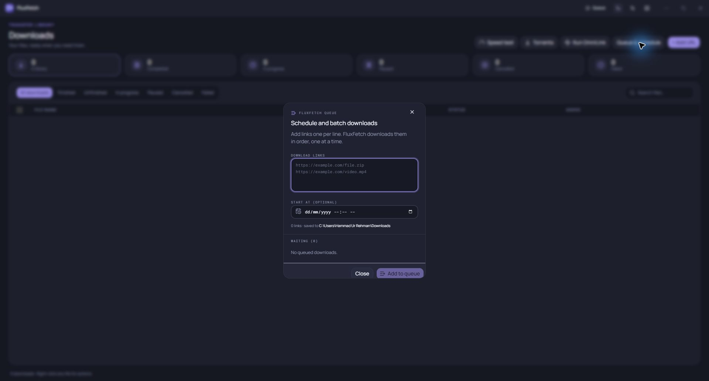
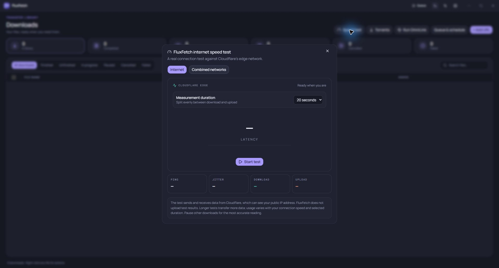

<div align="center">


# FluxFetch

**Your downloads. Your connections. One place to manage them.**

Concurrent downloads · Built-in torrents · Net Merge · OmniLink · Browser integration

[](https://github.com/SheedaMusalli/FluxFetch/releases/latest)
[](#install-fluxfetch)
[](LICENSE)

[Download FluxFetch 3.0.0](https://github.com/SheedaMusalli/FluxFetch/releases/latest) · [Browser setup](docs/BROWSER-SETUP.md) · [What's new in v3](docs/release-notes-3.0.0.md) · [Report an issue](https://github.com/SheedaMusalli/FluxFetch/issues)

</div>

FluxFetch is a Windows download manager with concurrent, resumable HTTP/HTTPS transfers, a built-in libtorrent engine, optional OmniLink acceleration for eligible game-launcher traffic, and Net Merge multi-adapter routing. Manage every active download and torrent in one library, extract encrypted archives, and send links from your browser.

## Features

| Feature                | What you can do                                                                                                                                                                      |
| ---------------------- | ------------------------------------------------------------------------------------------------------------------------------------------------------------------------------------ |
| Parallel downloads     | Run multiple direct downloads at once, split supported files across connections, select adapters, resume each transfer after restart, and retry failed parts.                         |
| Built-in torrents      | Download and seed magnets and `.torrent` files directly, without another torrent client or an installed Python runtime.                                                              |
| Live progress          | See every active direct download and torrent as its own library row with progress, speed, ETA and controls. The bottom live-transfer footer is reserved for torrents.                  |
| Torrent details        | Inspect files, per-file progress, trackers and errors, connected peers, ETA, uploads, ratio, DHT nodes, listening port and full content location. Open the download folder directly. |
| OmniLink               | Route eligible Steam and game-launcher connections through selected adapters and inspect launcher activity in the tray companion.                                                   |
| Net Merge              | Run the user-mode multi-network engine, inspect adapters and quotas, set per-adapter limits, and start or stop it from FluxFetch. Separate Internet connections are needed for added capacity. |
| Browser integration    | Capture supported downloads, send links through the context menu, find direct media, and download supported public YouTube videos. Chrome, Edge and Firefox packages are included. |
| Cleaner capture        | Automatic capture leaves ordinary images and known downloads smaller than 128 KiB in the browser. Explicit actions and torrent links are handled separately.                         |
| Download library       | View active direct downloads and torrents alongside completed history, with per-transfer controls, filters, search, resizable columns and persistent column preferences.             |
| File removal           | Remove history while keeping files, or explicitly confirm disk deletion. Torrents have separate keep-files and delete-files actions.                                                 |
| Queues and scheduling  | Add batches of URLs, manage waiting downloads and schedule queue starts.                                                                                                             |
| Torrent limits         | Set download and upload bandwidth caps for torrents from their details panel.                                                                                                         |
| Network tools          | Test Internet and combined-network speed, apply rate limits, configure HTTP/HTTPS/SOCKS proxies and save site authentication.                                                        |
| Archive tools          | Browse, search, test and extract archives; 7-Zip handles encrypted ZIP/AES and RAR formats. Add or remove archive entries in the manager.                                            |
| Optional remote access | Manage supported actions through an authenticated HTTPS dashboard, disabled by default.                                                                                              |
| Windows integration    | Clipboard download prompts, magnet and `.torrent` handling, system tray operation, and update checks against FluxFetch's GitHub releases.                                            |

## OmniLink for Steam

Click **Run OmniLink** beside **Speed test**, approve the Windows administrator prompt, then choose adapters from OmniLink's tray menu.

**Independent Internet connections are the key.** A desktop could use:

| PC adapter            | Connection                                                                                                |
| --------------------- | --------------------------------------------------------------------------------------------------------- |
| Ethernet              | Router A's Internet line                                                                                  |
| Wi-Fi                 | Router B's separate Internet line                                                                         |
| Android USB tethering | Router C's separate Internet line through the phone's Wi-Fi, if the phone supports sharing Wi-Fi over USB |

This makes more aggregate capacity available to eligible Steam transfers. Three routers sharing one upstream Internet line still share that line's capacity.

The compact, opaque overlay shows Steam running/not running and download activity. Speed is based on Steam traffic and stays at zero when no game download is detected. Expand the arrow for connection counts, adapter throughput, IP addresses, gateways and link rates. Newly connected routable adapters and address changes are detected while the helper runs.

Results depend on Steam's CDN, connection behavior, routing, bandwidth and compatible drivers. OmniLink can improve throughput but **does not guarantee a speed increase**. Its measurements may differ from Steam's display because sampling intervals and measured traffic differ.

## Net Merge

Open **Net Merge** from the Downloads Library to inspect adapter status and budgets, set per-adapter speed limits, and start or stop the engine. Net Merge routes eligible traffic through available interfaces; it does not turn separate adapters into one guaranteed faster connection. For added Internet capacity, use adapters connected to independent Internet lines. The same-router adapters share that line. Net Merge is user-mode; FluxFetch does not ship the experimental custom Windows kernel driver.

## Install FluxFetch

1. Open [Latest release](https://github.com/SheedaMusalli/FluxFetch/releases/latest) and expand **Assets**.
2. Download **`fluxfetch-3.0.0-setup.exe`**. GitHub's **Source code** ZIP is for developers, not installation.
3. Run setup on **Windows 10/11 x64**, review the license, choose the available installation options and destination, then review and install.
4. Existing users can choose **Update** to preserve settings/history, or **Fresh install** to reset this Windows account's settings, credentials and history while retaining downloaded files. Setup automatically closes the running app; finish important work first.
5. Open **Settings** in FluxFetch and select your default download folder.
6. Install the browser extension below if you want webpage capture. **Add URL**, clipboard prompts and **Torrents** also work without an extension.

The installer includes the local browser helper and lets you choose whether to install OmniLink and Net Merge. Each browser still needs its extension loaded separately. FluxFetch is not distributed through browser stores, and the Windows installer is not Authenticode-signed. Release checksums are available in `SHA256SUMS.txt`.

### Chromium: Chrome, Edge, Brave, Vivaldi, Opera and Opera GX

Use FluxFetch-Chrome.zip for Chrome and other Chromium browsers. Microsoft Edge has a separately named FluxFetch-Edge.zip package with the same Chromium extension code.

1. Download the matching ZIP from the same release: FluxFetch-Edge.zip for Edge, or FluxFetch-Chrome.zip for Chrome and other Chromium browsers. Extract it to a permanent folder, such as Documents\FluxFetch Extension.
2. Open your browser's extension page:

   | Browser                 | Page                                          |
   | ----------------------- | --------------------------------------------- |
   | Chrome                  | `chrome://extensions`                         |
   | Edge                    | `edge://extensions`                           |
   | Brave                   | `brave://extensions`                          |
   | Vivaldi                 | `vivaldi://extensions`                        |
   | Opera / Opera GX        | `opera://extensions`                          |
   | Other Chromium browsers | Browser menu → Extensions → Manage extensions |

3. Enable **Developer mode**, click **Load unpacked**, and select the folder directly containing **`manifest.json`**. Do not select the ZIP or its parent folder.
4. Pin **FluxFetch Download Manager**, open its popup and confirm **Connected**. Restart the browser after desktop installation if necessary.
5. Refresh open webpages. Download a supported file normally or right-click a direct link and choose **Download with FluxFetch**. The app asks before accepting it.

Keep the extracted folder in place. Other Chromium browsers need compatible Manifest V3 and Native Messaging support; loading alone does not confirm desktop connectivity. Setup registers Chrome/Edge host locations, which compatible forks may also use. These steps do not imply every browser fork has been tested.

The optional `FluxFetch-Chrome.crx` is a CRX3 package, **not a Chrome Web Store listing**. Use the ZIP steps where off-store CRX installation is restricted. See the [full browser guide](docs/BROWSER-SETUP.md) for updates and connection troubleshooting.

### Firefox

1. Download and extract **`FluxFetch-Firefox.zip`** from the same release. Use this package, not the Chromium ZIP.
2. Open **`about:debugging#/runtime/this-firefox`**.
3. Click **Load Temporary Add-on…** and select **`manifest.json`** inside the extracted Firefox folder.
4. Open the extension popup, confirm **Connected**, and refresh webpages.
5. Repeat temporary loading after Firefox restarts.

**This release's Firefox package is unsigned and temporary.** Renaming the ZIP to .xpi does not make it permanently installable in standard Firefox. Persistent distribution requires Mozilla signing. The release also includes FluxFetch-Firefox-source-2.0.zip for the source-code request in Mozilla's review workflow. See [Mozilla's instructions](https://extensionworkshop.com/documentation/develop/temporary-installation/) and the [FluxFetch browser guide](docs/BROWSER-SETUP.md).

## Using torrents

1. Click **Torrents**, paste a magnet/direct `.torrent` URL or choose **Open .torrent**, then confirm the destination.
2. FluxFetch creates the content folder when metadata arrives. **Saving to** shows the actual content path; **Open download folder** takes you there. Files are written as data arrives.
3. Expand **Torrent details** for Overview, Files, Trackers and Peers. **Find peers** requests fresh tracker/DHT discovery.
4. Track each torrent in the Downloads Library and the torrent-only footer, or use the tray tooltip without keeping the torrent dialog open.
5. Choose **Remove torrent (keep files)** to preserve data, or **Delete torrent and files** and confirm when you want disk data deleted too.

Right-click a `.torrent` file and select **Open with → FluxFetch**, setting it as default if desired. Select FluxFetch when Windows asks which app should open magnet links. Windows controls the default-app choice.

New and restored torrents use normal swarm piece selection, with DHT/PEX and supplied trackers for discovery. Sparse progress across files does not imply sequential mode. Speed depends on reachable peers, upload availability, your connection and rate limits. Older aria2 session records are not imported: re-add the original torrent with the **same destination** to verify and reuse files.

## YouTube and direct media

The extension adds controls for supported public YouTube videos and direct audio/video sources. Choose a format and confirm the job. The desktop downloader prefers audio tracks identified as original, then tracks matching the video's language, before falling back to the best available audio. Verified tools download on first use; FFmpeg is fetched when muxing is needed.

DRM, live broadcasts, interactive challenges and some sign-in/region restrictions remain unsupported. General HLS/DASH, `blob:` URLs and POST-generated files are not ordinary direct-file capture. YouTube jobs do not persist across an app restart. See [Windows integration details](WINDOWS-SETUP.md).

## Screenshots



<details>
<summary>Download setup, queues and speed tests</summary>





</details>

## Troubleshooting

| Problem                         | What to check                                                                                                                                                                                              |
| ------------------------------- | ---------------------------------------------------------------------------------------------------------------------------------------------------------------------------------------------------------- |
| Extension disconnected          | Install the desktop app, reopen the browser and confirm the correct package/identity. Run setup in Update mode to repair the helper. See [browser troubleshooting](docs/BROWSER-SETUP.md#troubleshooting). |
| Nothing captured                | Check capture toggle and site exclusions. Images, known small files, private sessions and unsupported requests may stay in the browser. Try an explicit direct-link action.                                |
| Slow/waiting torrent            | Inspect Peers, Trackers, DHT count, rate limits and connectivity. A torrent needs reachable peers with the data.                                                                                           |
| Can't find torrent files        | Read **Saving to** in Overview and use **Open download folder**. Magnets need metadata before file names are known.                                                                                        |
| Files disappeared after removal | The trash action deletes disk data after confirmation. Use **Remove torrent (keep files)** to remove only the job.                                                                                         |
| Upgrading                       | Install in Update mode, then replace/reload the extension. Preserve its manifest key and Firefox ID.                                                                                                       |

## Build from source

Requirements: Windows 10/11 x64, Node.js 22.12+, npm, Windows PowerShell, Rust MSVC with C++ build tools for OmniLink, and the Windows .NET Framework C# compiler for the browser helper. The build fetches hash-pinned Python/libtorrent binaries; users do not need Python installed.

```powershell
git clone https://github.com/SheedaMusalli/FluxFetch.git
cd FluxFetch
npm ci
npm run build:win
```

Installer and browser packages appear in `release/`. See [Windows build instructions](WINDOWS-SETUP.md), [torrent architecture](integrations/torrent-engine/README.md) and [component notices](THIRD-PARTY-MEDIA.md).

```powershell
npm run lint
npm run typecheck
npm run test:extension
npm run test:torrent-engine
npx playwright test e2e/torrent.spec.ts e2e/transferStatus.spec.ts --workers=1
```

Chromium identity depends on a private local extension signing key. Keep it private; a new key produces a new ID and matching native-host registration.

## Privacy and licenses

Downloads transfer directly between your PC and their sources. Browser integration uses a local Native Messaging helper. Authentication secrets use Windows encryption where supported. Speed tests contact Cloudflare measurement endpoints. Torrents contact trackers and peers; public torrents may use DHT/PEX. Optional remote access uses authenticated HTTPS and a local certificate; verify its fingerprint before trusting it.

FluxFetch application code uses the [MIT License](LICENSE). Bundled engines, drivers and media tools retain their own licenses: see [THIRD-PARTY-MEDIA.md](THIRD-PARTY-MEDIA.md) and [third-party-licenses](third-party-licenses).
