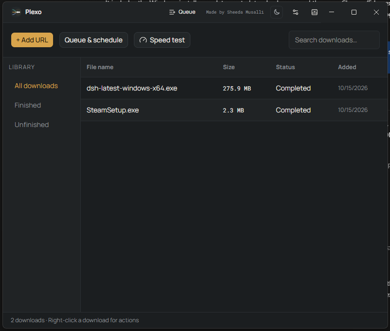
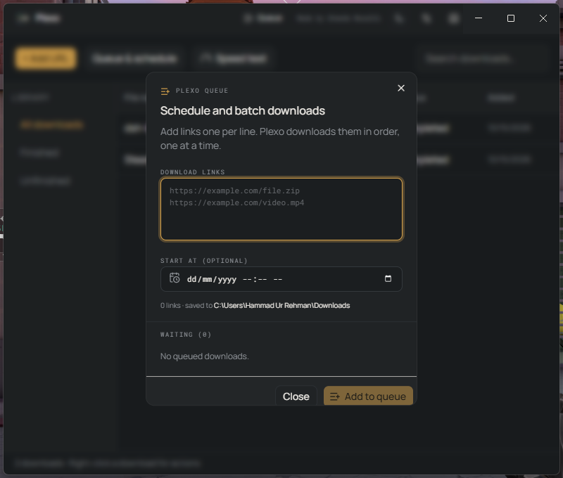
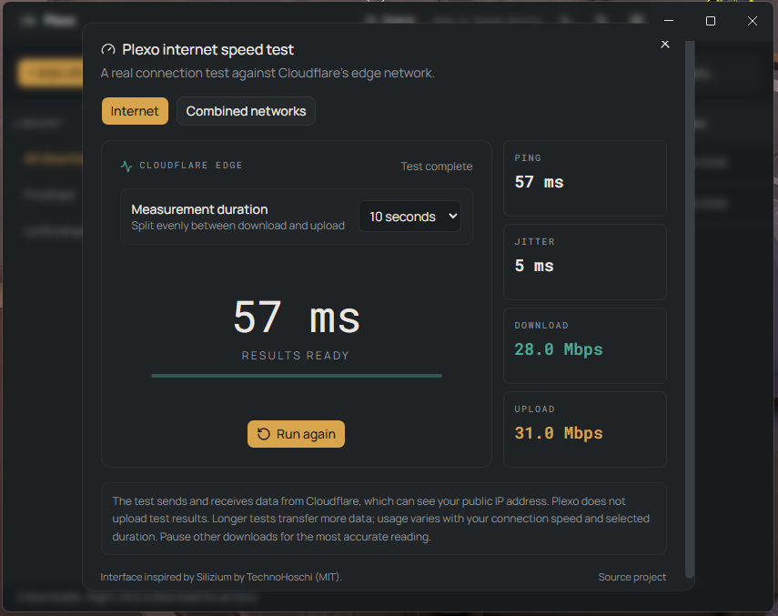
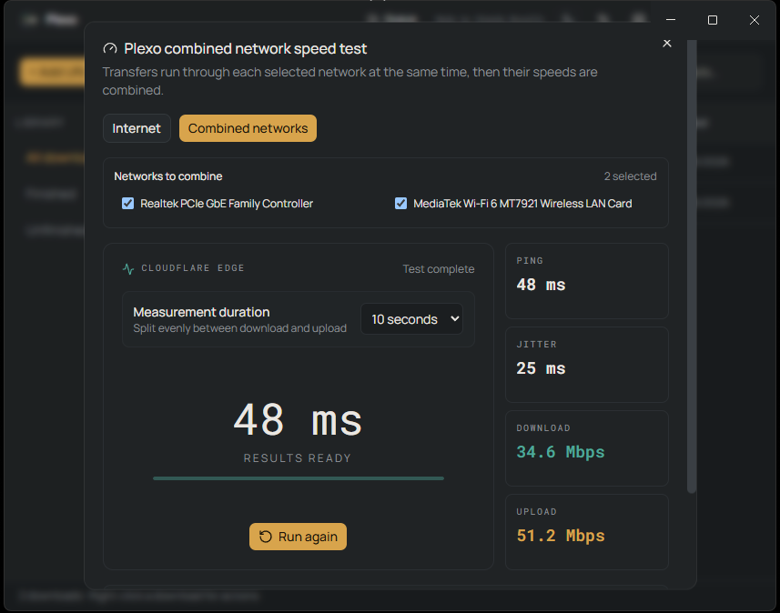

<div align="center">


# FluxFetch

**Fast, resumable downloads across the connections you choose.**

[Windows 10/11](#installation) · [Features](#features) · [Build from source](#build-from-source)

</div>

FluxFetch can split supported files into parallel streams, route them across selected network interfaces, resume interrupted downloads, and keep everything organized in a searchable library.

[](https://github.com/SheedaMusalli/FluxFetch/releases/latest) [](#installation) [](LICENSE)

## Features

- **Parallel and multi-network downloads** — split supported HTTP/HTTPS downloads into streams and route them through the network adapters you choose. Speed depends on the source server, connection, and network setup.
- **Reliable transfers** — resume supported interrupted downloads, retry failed parts, and see per-network progress, throughput, average speed, and peak speed.
- **Browser handoff** — use the Chrome or Edge extension to send links to FluxFetch, or let clipboard monitoring offer a download prompt when you copy a URL.
- **Download library** — search and filter history, open completed files, view their location and properties, refresh expired links from the source page, and batch-remove history entries.
- **Queues and scheduling** — add batches of URLs and optionally schedule when a queue starts.
- **Useful tools** — measure internet speed, inspect and selectively extract ZIP/RAR archives, apply download speed limits, configure proxies and authentication, and send magnet or `.torrent` links to a local qBittorrent Web UI.
- **Optional OmniLink integration** — launch the separately packaged helper for Steam multi-interface routing. It requires Windows administrator approval and compatible network-driver support; it cannot guarantee faster Steam downloads.

## Screenshots

### Download library



### Download setup and network selection


### Queue and scheduling



### Speed tests





## Installation

1. Download **`fluxfetch-1.0.0-setup.exe`** from the [FluxFetch v1.0.0 release](https://github.com/SheedaMusalli/FluxFetch/releases/latest) and run the installer.
2. Download **`FluxFetch-Chrome.zip`** from that release and extract it to a permanent folder.
3. In Chrome, open `chrome://extensions`; in Edge, open `edge://extensions`. Enable **Developer mode**, choose **Load unpacked**, and select the extracted extension folder containing `manifest.json`.
4. Pin **FluxFetch Download Manager** in the browser. Confirm the extension shows **Connected**.
5. Start downloads from a webpage, use **Download with FluxFetch** on a link, or paste a direct URL into the app.

For torrent links, configure qBittorrent Web UI in FluxFetch settings first. FluxFetch hands magnet and torrent-file links to your local qBittorrent instance after confirmation; it does not include a BitTorrent engine.

## Build from source

Requirements: Windows 10/11 x64, Node.js 22.12+, npm, .NET SDK, Windows PowerShell, and the stable Rust MSVC toolchain. OmniLink uses the Rust MSVC toolchain and its bundled WinDivert runtime. Review [Windows build instructions](WINDOWS-SETUP.md) and [third-party notices](THIRD-PARTY-MEDIA.md).

```powershell
git clone https://github.com/SheedaMusalli/FluxFetch.git
cd FluxFetch
npm install
npm run build:win
```

The Windows installer is written to `release/`. E2E tests can be run with `npm run test:e2e`.

## Privacy and safety

Downloads are transferred directly between your PC and the configured file host. Internet speed tests send timed requests to Cloudflare's public measurement endpoints. The optional remote dashboard serves over HTTPS and should only be exposed beyond your PC when you understand and secure your network and router configuration. Credentials and tokens are protected using Windows encryption where supported. See [third-party notices](THIRD-PARTY-MEDIA.md) for bundled component details.

## License

FluxFetch is distributed under the MIT License. See [LICENSE](LICENSE) and the included third-party notices for applicable component terms.
